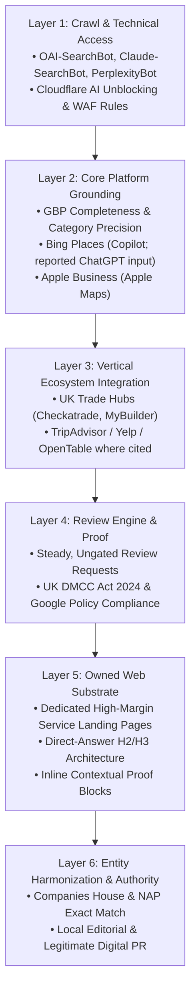
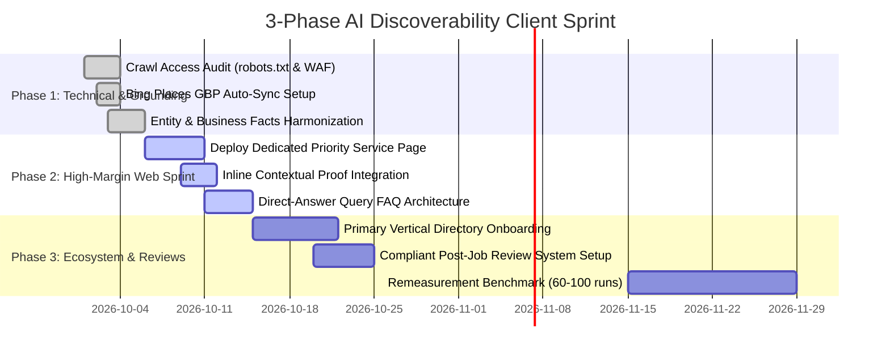

# Local AI Discoverability: Implementation Playbook & Standard Operating Procedure (SOP)

> **Reviewed 30 October 2026.** The rating cutoffs, universal inclusion/exclusion claims and unsupported
> mechanisms flagged on 1 October were removed or scoped. Figures come from the 20 September research notes,
> which link each source; the pages were not re-read for this review. Most studies cited are vendor or agency
> work, mostly US, and none covers Brighton: use them as context, never as rules.
> See [the review record](../docs/sales-language-review.md).

**Date:** 20 September 2026  
**Document Type:** Technical & Operational Implementation Playbook  
**Target Audience:** Agency Technical Delivery Team & Client Account Managers  
**Scope:** UK Local Service Businesses (Trades, Commercial Cleaning, Hospitality, Professional Services)

---

## Executive Overview

Traditional Local SEO was largely single-platform (ranking in Google’s Local 3-Pack via Google Business Profile and local backlinks). **Generative Engine Optimization (GEO) and AI Discoverability operate across a multi-platform consensus model.**

AI assistants (ChatGPT Search, Google Gemini/AI Mode, Claude, Perplexity) do not rely on a single index or your owned website alone:
* **Google AI Mode** drew **79.8% of local-intent citations from Google Maps/GBP** in one US vendor study (Steady Demand, Aug 2026, 50 metros), while AI Overviews mostly cited business websites (70.7%).
* **ChatGPT Search:** OpenAI names only "third-party search providers" and partners. Bing rank is the strongest reported predictor (Seer, reportedly 87% alignment), but independent tests suggest other sources too. Yelp data was reportedly licensed to OpenAI in July 2026; the deal's details are not verified.
* **Claude web search** uses **Brave Search** (Brave is on Anthropic's subprocessor list).
* **UK trades:** in one small agency test (Murray Digital, Aug 2026: 80 ChatGPT prompts, one run each), **71.9% of cited sources were trade directories** such as Checkatrade and MyBuilder.

This SOP translates our **6-Layer Multi-Lever Hierarchy** into concrete, repeatable engineering and operational workflows mapped across a **3-Phase Client Discovery Sprint**.

---

## Part 1: The 6-Layer Multi-Lever Implementation Guide



---

### Layer 1: Crawl & Technical Access (The Gatekeeper)

If an AI search crawler is blocked, that tool cannot read the site when it answers. It is cheap to check and fix, so check it first.

#### 1. Understanding Search Bots vs. Training Bots
Clients often fear AI scraping their intellectual property for model training. We must distinguish **Search Grounding Bots** (which fetch pages for live answers) from **Training Crawlers** (which scrape data for foundational models).

| Bot Name | Operator | Role | Agency Policy |
| :--- | :--- | :--- | :--- |
| `OAI-SearchBot` | OpenAI | Powers ChatGPT Search grounding | **MUST ALLOW** |
| `ChatGPT-User` | OpenAI | User-initiated on-demand fetching | **MUST ALLOW** |
| `GPTBot` | OpenAI | Pre-training foundation models | Client Discretion (Can block) |
| `Claude-SearchBot` | Anthropic | Fetches pages for Claude's search answers | **MUST ALLOW** |
| `ClaudeBot` | Anthropic | Training & broad crawl | Client Discretion (Can block) |
| `PerplexityBot` | Perplexity | Real-time answer retrieval | **MUST ALLOW** |
| `Googlebot` | Google | General Google search & AI Overviews | **MUST ALLOW** |
| `Google-Extended`| Google | Gemini model training opt-out | Client Discretion (Does not affect search) |
| `Bingbot` | Microsoft | Feeds Bing, Copilot, & ChatGPT Search | **MUST ALLOW** |

#### 2. Golden Standard `robots.txt` Configuration
Deploy this block at the root of the client’s site:

```txt
# ========================================================
# ALLOW SEARCH-GROUNDING AI ASSISTANTS (Mandatory for AI Visibility)
# ========================================================
User-agent: OAI-SearchBot
Allow: /

User-agent: ChatGPT-User
Allow: /

User-agent: Claude-SearchBot
Allow: /

User-agent: PerplexityBot
Allow: /

User-agent: Bingbot
Allow: /

User-agent: Googlebot
Allow: /

# ========================================================
# OPTIONAL: BLOCK TRAINING/SCRAPING IF CLIENT REQUESTS
# (Does NOT harm real-time search recommendation)
# ========================================================
User-agent: GPTBot
Disallow: /

User-agent: Google-Extended
Disallow: /

User-agent: ClaudeBot
Disallow: /
```

#### 3. Cloudflare & WAF Configuration Audit
* **Why:** Cloudflare and similar services offer AI-crawler blocking that can stop these bots even when `robots.txt` allows them, and it may be on without the owner knowing.
* **Audit Action:** 
  1. Log into Cloudflare Dashboard $\rightarrow$ **Security** $\rightarrow$ **Bots**.
  2. Check whether AI crawler blocking is on and which bots it covers. Keep search bots (`OAI-SearchBot`, `Claude-SearchBot`, `PerplexityBot`) allowed if the client wants AI search visibility.
  3. Allow them through Cloudflare's verified-bot controls. Do not bypass security with a user-agent text match: anyone can send that text.

---

### Layer 2: Core Platform Grounding (Google, Bing, Apple)

Local AI recommendations rely on trusted geospatial and business registries.

#### 1. Google Business Profile (GBP) Optimization
* **Primary Category Precision:** Choose the most specific accurate category. No study shows it is a top factor for AI answers (Whitespark's expert panel ranked it #34 for AI search), but GBP is a main source for Google's own AI surfaces, so accuracy matters. Avoid generic categories.
  * *Bad:* "Cleaning Service"
  * *Good:* "Commercial Cleaning Service" (if office contracts are priority) or "Carpet Cleaning Service".
* **Secondary Categories:** Add up to 5 specific secondary categories (e.g., *Upholstery Cleaning Service*, *End of Tenancy Cleaning Service*, *Window Cleaning Service*).
* **Predefined Services List:** Manually populate every single predefined service item with a clear pricing description and geographic delivery radius.
* **Geocoding & Operating Areas:** Clearly define postal districts (e.g., BN1, BN2, BN3, BN41 for Brighton & Hove) rather than typing "Sussex".

#### 2. Bing Places (Copilot, and a reported input to ChatGPT)
* Copilot uses Bing, and Bing rank is the strongest reported (but contested) predictor of ChatGPT citations, so claim Bing Places.
* **The 15-Minute Setup:**
  1. Access [Bing Places for Business](https://www.bingplaces.com/).
  2. Choose **"Import from Google Business Profile"**.
  3. Check whether ongoing sync is offered for the listing. If not, update Bing whenever GBP changes (hours, photos, services).
  4. Access **Bing Webmaster Tools** $\rightarrow$ **AI Performance** report (public preview since Feb 2026) for first-party data on AI citations of the site.

#### 3. Apple Business (Apple Maps)
* Apple Business (2026) manages Apple Maps place cards. How Siri chooses local businesses is not documented, so treat it as a low-cost listing, not an AI lever.
* Claim the location card, upload high-resolution cover photos, set primary categories, and add direct action links (e.g., "Request a Quote" linked directly to the client's service landing page).

---

### Layer 3: Vertical Ecosystem Integration (Sector Hubs)

For local questions such as *"Who should I hire for X?"*, AI answers often cite third-party directories and lists alongside, or instead of, business websites.

#### 1. UK Trades & Property Maintenance Prioritization
In Murray Digital's August 2026 test (80 ChatGPT prompts across 8 trades and 10 UK towns, one run each; an agency selling local SEO), **71.9% of the 405 cited sources were trade directories** and only 2 answers cited the business's own site.
* **Checkatrade:** 
  * Cited in **78 of 80 answers** in that test.
  * Checkatrade also has an app inside ChatGPT. How ChatGPT uses it in ordinary answers is not documented.
* **MyBuilder:** Cited in **70 of 80 answers**.
* **TrustATrader & Which? Trusted Traders:** Also cited.
* **Action:** For property maintenance, cleaning, building, and trades, an accurate, vetted profile on at least *one* of these platforms is strongly recommended.

#### 2. Hospitality, Leisure & General Local
* **Yelp:** Yelp data was reportedly licensed to OpenAI in July 2026 (details not verified). BrightLocal's August 2026 study found Yelp heavily cited by ChatGPT, but mostly outside the UK, with no UK-only breakdown. A free listing costs little; check it is cited for the client's market before prioritising it.
* **TripAdvisor & OpenTable:** Often cited for food, hospitality and leisure. Check which ones appear in the client's own test answers.

---

### Layer 4: Review Engine & Reputation Architecture

Reviews are public evidence of what a business delivers, for customers and for any AI tool that reads them. No study isolates how much ratings, volume or wording change AI recommendations.

#### 1. Ratings: what the evidence shows
* In Steady Demand's index (US, vendor), **90% of AI-recommended local businesses were rated 4.5 or above**, averaging **4.75**, slightly *below* the 4.84 of ordinary search results.
* That describes who was recommended. It is not a cutoff, and there is no evidence for a rating below which businesses are excluded.

#### 2. Strict Legal Compliance: The UK DMCC Act 2024 & CMA208
As of April 2025, the **Digital Markets, Competition and Consumers (DMCC) Act 2024** is legally in force under the Competition and Markets Authority (CMA). The CMA has statutory powers to levy fines of **up to 10% of global annual turnover** for misleading review practices.

```
┌─────────────────────────────────────────────────────────────────────────┐
│                      CRITICAL COMPLIANCE NOTICE                         │
│ Under the DMCC Act 2024 Schedule 20 and CMA Guidance CMA208:             │
│ 1. NEVER incentivize reviews (no discounts, vouchers, cash, or freebies).│
│ 2. NEVER engage in "Review Gating" (sending happy customers to Google   │
│    and unhappy customers to a private feedback form).                   │
│ 3. NEVER publish misleading proof (omitting genuine negative reviews    │
│    or writing fake case studies).                                       │
│ 4. Google's Terms of Service separately prohibit selective solicitation. │
└─────────────────────────────────────────────────────────────────────────┘
```

#### 3. Compliant Review Generation Workflow
* **The "Universal Post-Job Ask":** Send an automated, neutral SMS or email to **100% of customers** 2–4 hours after job completion.
* **Compliant Prompting:** Do *not* ask for "a 5-star review". Ask for specific descriptive feedback:
  * *Template:* "Hi [Name], thank you for choosing [Company] today! Could you take 60 seconds to leave us an honest review on Google? If you mention which service we provided (e.g., office cleaning, carpet clean), it helps our local team immensely: [Short Link]"
* **Service Names in Reviews:** When customers mention the service (*"carpet cleaning"*, *"commercial tenancy"*), the review becomes specific evidence that a reader or an AI tool can quote. Treat it as good practice; it is not verified proof, and no study shows it changes recommendations.

#### 4. The Owner Reply Protocol
* Respond to every review within 48 hours, honestly and specifically. It helps customers; no study shows replies change AI recommendations.
* **Response Template:** Incorporate the service and locality naturally:
  * *"Thank you for the feedback, [Name]! Our team takes great pride in delivering commercial office cleaning across Brighton & Hove. We look forward to seeing you next week."*

---

### Layer 5: Owned Web Substrate (High-Yield Page Architecture)

Once the off-site and grounding layers are in place, the website acts as the final factual anchor. We eliminate unproven gimmicks (`llms.txt`, hidden prompt injection) in favor of **structured, direct-answer page architecture**.

#### 1. Dedicated Priority Service Landing Pages
Never lump high-margin services into a single bulleted "Services" overview. Each priority requires a dedicated URL (e.g., `udrproperties.co.uk/commercial-cleaning-brighton`).

**Essential Page Anatomy:**
```
[ H1: Service Title + Primary Location ]
  └── Clear 2-sentence summary answering: Who, What, Where.

[ Quick-Facts Matrix (Table or Definition List) ]
  ├── Service Scope: Exactly what is included & excluded.
  ├── Sectors Served: Offices, medical clinics, retail, schools.
  ├── Compliance/Specs: COSHH certified, £5M Public Liability, DBS checked.
  ├── Commercial Terms: Key-holding, invoicing, VAT status, frequencies.
  └── Service Area: Brighton, Hove, Portslade, Shoreham, Lewes.

[ The Inline Customer Proof Block ]
  └── 2-3 verbatim Google reviews specifically referencing THIS service.
  └── Source citation, reviewer first name, and date.

[ Direct-Answer FAQ (H2/H3 Fan-Out Match) ]
  └── "How often do you provide commercial office cleaning?"
  └── "Do you provide your own commercial equipment and eco-friendly products?"
  └── "What are your key-holding and security procedures?"

[ Clear Actionable CTA ]
  └── Telephone number, direct email, free quote booking form.
```

#### 2. Direct-Answer Formatting for LLM Extraction
Question headings followed by a short factual answer (40–60 words) are easy for people and AI tools to quote. Good practice; no study isolates its effect:

```markdown
### What is included in your Brighton end-of-tenancy clean?
Our Brighton end-of-tenancy cleaning strictly adheres to agency inventory checklists. It covers deep kitchen degreasing, oven cleaning, full bathroom descaling, inside window cleaning, and skirting board washing. Carpet steam cleaning can be added as a combined package.
```

---

### Layer 6: Entity Harmonization & Authority (The Anchor)

Inconsistent names and dates make it harder for anyone, including AI tools, to tell that two mentions are the same business. Our own tests show the effect on counting: UDR Properties was recommended as "UDR Cleaning" in 6 of 72 answers on 12 October 2026. Whether it changes what the AI recommends is not established.

#### 1. Reconciling Legal Name vs. Trading Name
Take UDR Properties as a direct example:
* **The Conflict:** Saved pages listed establishment as both **2017** and **2018**, with mentions of both *UDR Cleaning* and *UDR Properties Limited*.
* **The Resolution:** Publish a standard, canonical Business Identity block in the website footer and schema:
  * *Legal Name:* UDR Properties Limited
  * *Trading Name:* UDR Cleaning & Property Services
  * *Company Registration No:* [Companies House 8-digit ID]
  * *Established:* 2017 (Founded) / Incorporated 2018
  * *Registered Office:* Exact address matching Companies House and GBP.

#### 2. Digital PR & Legitimate Local Editorial
* **Warning on Paid Listicles:** Google says it is acting against self-promotional listicles, and Lily Ray documented January 2026 visibility drops for sites that used them heavily (mostly large SaaS sites). Paying for undisclosed "Top 10" placements also breaches UK advertising rules (ASA/CAP).
* **Legitimate Local PR Tactics:**
  * Submit expert commentary or local business milestone stories to local publications (*The Argus*, *Brighton & Hove News*, *Latest Brighton*).
  * Register with local chambers of commerce (*Brighton Chamber*, *Federation of Small Businesses*).
  * Ensure presence in verified local authority directories (*VisitBrighton* where applicable).

---

## Part 2: The 3-Phase Discovery Sprint (Replacing Actions 1–3)

When presenting our recommendations to clients, we replace the narrow on-site recommendations with this structured 3-Phase Delivery Sprint (example schedule; dates and statuses are illustrative):



### Phase 1: Technical Accessibility & Entity Grounding (Weeks 1–2)
*Goal: Little client effort. Make sure AI search crawlers can reach the site and the core listings are accurate.*
* **Action 1.1:** Audit and update `robots.txt` and Cloudflare WAF rules to ensure `OAI-SearchBot`, `Claude-SearchBot`, and `PerplexityBot` have unrestricted access.
* **Action 1.2:** Import Google Business Profile into **Bing Places** and claim **Apple Business**.
* **Action 1.3:** Publish a canonical entity statement on the website footer harmonizing Companies House data, trading names, and founding dates.

### Phase 2: High-Margin Service Landing & Inline Proof (Weeks 3–4)
*Goal: Build the owned content substrate for the client's #1 most profitable service category.*
* **Action 2.1:** Design and launch a dedicated, standalone landing page for their top priority (e.g., *Commercial Office Cleaning Brighton*).
* **Action 2.2:** Embed verified, relevant customer proof blocks directly adjacent to the service description, explicitly answering commercial buyer concerns (insurance, key-holding, frequencies).
* **Action 2.3:** Add structured direct-answer FAQs targeting high-intent fan-out queries.

### Phase 3: Category Consideration Set & Review Engine (Weeks 5–8)
*Goal: Accurate listings on the platforms cited for the client's sector, and a steady, compliant flow of reviews.*
* **Action 3.1:** Complete verification on the dominant sector platform (e.g., Checkatrade for trades/cleaning; TripAdvisor/Yelp for hospitality).
* **Action 3.2:** Implement an automated post-job review invitation workflow adhering strictly to the UK DMCC Act 2024.
* **Action 3.3 (Follow-up at 8–12 Weeks):** Execute a complete 72-answer remeasurement benchmark to quantify visibility shifts against baseline competitors.

---

## Part 3: Operational Checklist for Client Delivery

| Task | Assignee | Tool / Platform | Target Time | Verified Output |
| :--- | :--- | :--- | :--- | :--- |
| **Robots.txt & WAF Check** | Tech Lead | cURL / Cloudflare Dashboard | 30 mins | Bot HTTP 200 responses |
| **Bing Places Import** | SEO Ops | Bing Places Admin | 20 mins | Listing live and matching GBP |
| **Apple Business** | SEO Ops | Apple Business Portal | 30 mins | Verified place card |
| **Entity Facts Alignment** | Copywriter | WordPress / Webflow CMS | 45 mins | Updated canonical footer |
| **Priority Service Page** | Web Dev | CMS / Page Builder | 3–4 hours | Live indexable URL |
| **Proof Block Embedding** | Web Dev | CMS | 1 hour | Published review blocks |
| **Vertical Directory Setup** | Client / Ops | Checkatrade / Yelp Portal | 1–2 hours | Live verified profile |
| **Review Workflow Setup** | SEO Ops | CRM / Email / SMS Tool | 1 hour | Automated send trigger |

---

## Summary

By executing across all 6 layers rather than treating AI Discoverability as a cosmetic website edit:
1. We work on the sources AI search tools are **known or reported to use** (Maps, Bing, directories, reviews, and websites), and measure the result rather than promise it.
2. We insulate clients from **legal and search-spam penalties** by strictly rejecting prompt-injection tricks, cloaking, and review gating.
3. We provide clients with a structured, professional roadmap that delivers immediate technical value while building long-term commercial discoverability.
